# Floor Planner

A 2D architectural floor-plan editor in Python and PyQt6 — walls, doors and
windows, rooms that own their walls, true-scale furnishings, roofs with
dormers, annotations and measurements, multi-floor plans, a 3D view, and
exports to PDF plan sheets and Chief Architect. Run `python FloorPlanner.py`
(or the `floorplanner` console script). Everything the app and its tools do is
listed, with an example each, in **[`docs/COMMANDS.md`](docs/COMMANDS.md)**.

**App version 1.2** (`APP_VERSION` in `floorplanner/config.py`). **The plan
file is a version‑6 `floorplanner-design` document** — the JSON Schema is
`floorplanner/design/design-schema.v6.json` ([`docs/design-schema.v6.md`](docs/design-schema.v6.md));
a version‑5 file opens unchanged and is written back as 6; a v1–v4
`floorplanner-json` plan is converted on open and reported. The model behind
it is [`docs/DESIGN_MODEL_v5.md`](docs/DESIGN_MODEL_v5.md): a room owns an
outline of shared vertices, walls are bindings onto its edges, and vertices
are the only coordinates in the file.


📸 **[Feature gallery](docs/gallery/)** — a screenshot per feature.

## Features

- **Walls** — exterior (6") and interior (4½") walls drawn by click-drag,
  orthogonal from the anchor and **landing on the snap grid** (Shift =
  unconstrained: off the grid, any angle). While drawing, the endpoint snaps
  to line up with the projected line of a nearby open-ended wall; nothing
  auto-grows — a gap is left for you to close. Shared endpoints join into
  mitred corners (one shared **vertex** per corner: move it and every wall and
  room outline that holds it follows). Dragging a wall's body slides it
  orthogonally and the attached walls stretch (Ctrl for free movement).
  Overlapping same-type walls **coalesce**; an end released on a wall
  **welds** a T or L joint. **Edit ▸ Wall orthogonality report** finds the
  walls a fraction off axis; **Repair wall orthogonality** squares them.
  Double-click a wall for its **property sheet** (name, type, thickness,
  length, heading, level, rooms, openings, its id).
- **Doors & windows** — placed on a wall with WWHH sizes (`3280` = 32" × 80"),
  they cut the opening and ride the wall when dragged. Door types: LH, RH,
  bifold, pocket, slider, French, doorway, and single / double **garage
  doors**. A window carries its **sill height** (a plan default of 36", set
  per window in its properties). On a shared boundary an opening belongs to
  one wall and the wall beside it opens for it — one clean opening.
- **Rooms** — click inside any enclosed area to name it. The room traces its
  perimeter along the wall centrelines, computes the true interior area, can
  draw dimension arrows on every enclosing wall, and carries a property sheet
  (type, ceiling, finishes, HVAC, notes, *include in total square footage*).
  A labelled room **owns its boundary walls**: drag the name to move the whole
  room — walls, doors and windows travel together. Detach a wall to unlock its
  corners; drag a corner along the wall and the side **opens** (drawn dashed);
  drag it back and it fuses. **Extract** a room to float it as a movable unit
  and **join** it back; save a floated room as a **template** and load it onto
  another plan. Right-click a room name for its **inventory** (copy as TSV).
  **Concept rooms** mark areas with no walls (quarantined on export).
- **Roofs** — sketch a **ridge** over the house (the heights dialog sets the
  eaves and ridge; the pitch follows), choose the **form** — gable, **hip**
  (with a settable run per end) or **shed** — and the eaves span and overhang
  per side. Sketch a **dormer** on a roof plane: its sides and face are
  projected up from the host roof, and it takes its own windows. Roofs clip
  each other along their valleys and seams (a pure clipper, measured fast
  enough for fifteen roofs); the lower roof runs under the overhang; the
  **End-On** dialog draws the section it edits. *Roof ▸ Show roof / Edit roof*
  switch the drawing and the grips.
- **Floors** — any number of levels, each with an elevation and a wall
  height; the active floor paints on top and the others ghost beneath
  (*Floors ▸ Show other floors*). **Ctrl+F** pops the floor selector,
  **Ctrl+Shift+F** makes a floor, **Ctrl+PgUp/PgDown** cycle. A reference
  floor (a site or lot level) is skipped by the exporters.
- **3D view** — **Ctrl+3** renders the current plan read-only: walls cut by
  their openings, floors, roofs with their dormers, posts running from their
  level to the roof above, furnishings as blocks. The same builder is the
  command-line viewer (`floorplanner.viewer.fp3d`, pyqtgraph) and its Qt
  Quick 3D twin (`fp3dq`), both of which take a camera and write a PNG.
- **Annotations, measurements, leaders and item callouts** — the **Show** menu
  switches each layer on and off independently and saves the choice with the
  plan. *Annotations*: the **T** tool places a text at a click (drag to move,
  double-click to edit); the **N** tool draws a **leader** — press on the
  thing to name (the point snaps as a measure's end does), drag to where the
  text goes, type it: an arrow at the point, the text on a short shoulder,
  two knobs when selected. *Measurements*: the **L** tool drags a measure
  from one point to another — each end snaps to a corner, a wall, an
  opening's jamb or the level's **datum** (*Show ▸ Place datum*), both ends on
  one wall and the measure runs along it — drawn as one thin line with a
  slash at each end and the length above it, in feet-and-inches or inches
  (*Show ▸ Measurements in feet and inches*). Select a measure for its four
  small black knobs: the two callout points (drag to move; **Ctrl**-drag
  turns the measure about the other point on the rotation snap, **Shift**
  frees it), the line's end and the label. *Item callouts* (on when a plan
  opens): every item's **session label** — `W7`, `V12`, `O3`, `R2`, `F4`,
  `RF1`, taken from the file's own ids when the plan opens so the two
  match — and its name where set, in one small font and a settable colour
  (*Show ▸ Item callout colour…*, default blue). The **Malformed design
  file** report says the same labels and **zooms to** a reported row.
- **Furnishings** — a bundled CC0 library of 96 top-view symbols across
  Living, Dining, Kitchen (appliances, base, wall and pantry cabinets,
  islands), Bedroom, Bathroom (fixtures and vanity bases), Laundry, Office /
  Storage, Garage (cars, boat and trailer, tractor, mower), Shop, Sunroom,
  HVAC (furnaces, water heaters, tanks, the electric panel, a car charger, a
  battery wall) and Framing (stairs, an elevator, a **post**). Drag one from
  the right-hand palette and it lands at **true scale** (a 16' SUV takes up
  16'); placed items move with 1" snap and rotate via a grab handle (Ctrl =
  snap to the configured increment).
- **Stairs** — the Framing stairs symbol draws the right number of steps for
  the ceiling height of the room it sits in and shows an **UP / DN** arrow;
  right-click for a full flight, a half flight to a landing that ends or
  turns left / right, and the travel direction.
- **Groups & multi-select** — Ctrl+drag a rubber band (it takes only what it
  fully encloses, so a room can be lassoed without its party walls) or
  Ctrl+click to toggle items. **Ctrl+G** groups the set to move it as one —
  walls, furnishings and the rooms they enclose — with a rotation handle;
  **Ctrl+Shift+G** ungroups. Groups cut, copy and paste.
- **Room boolean operations** — select two rooms and the **Rooms** menu
  treats their perimeters as polygons: *Combine*, *Intersect*, *Subtract*,
  and *Fragment* (three fully walled pieces, each its own group). *Align to
  grid*, *Distribute horizontally / vertically* and *Refresh rooms* tidy up.
- **Nudging, undo, clipboard** — arrow keys move the selection by the snap
  step (Ctrl = 1"); **Ctrl+Z / Ctrl+Y** step through every canvas operation;
  **Ctrl+X / C / V** cut, copy and paste; **Ctrl+Shift+V** pastes a room.
- **Inventory menu** — Excel-ready tables for the whole plan: *House* (rooms,
  doors, windows, walls), *Interior furnishings*, *Yard items* and *Total*
  (with the building cost at the cost per square foot in Settings); the
  toolbar shows the live **Totals: Cost / Sq. Feet**.
- **AI pricing** — **AI ▸ Update furnishing prices…** asks an AI (Anthropic
  Claude) for current retail prices for the catalog and writes them into each
  furnishing's `price`; the key comes from the dialog or `ANTHROPIC_API_KEY`.
- **PDF plan set** — **File ▸ Export ▸ PDF plan set…** writes one 11×17 sheet
  per level at a standard architectural scale: walls as face pairs, door and
  window symbols with their size codes, room labels, and dimension strings —
  **the plan's own drawn measurements** on any level that has them (while
  shown), else the auto rows along two edges and an angled lane per family;
  texts and leaders print while *Show ▸ Annotations* is on; a title block.
- **Export to Chief Architect (DXF)** — **File ▸ Export ▸ Chief Architect
  (DXF)…** writes a purpose-built DXF R12 file (plus a sidecar) per storey
  level for Chief Architect X17's **CAD to Walls** importer. See
  [below](#export-to-chief-architect-dxf) for the verified workflow.
- **Room import / export (CSV)** — `Name,Type,X_ft,Y_ft,X_loc_ft,Y_loc_ft,Notes`;
  unlocated rooms auto-place and the canvas grows to fit (to 500').
- **Import from a PNG** — a raster plan as a calibrated backdrop, its walls
  extracted into the plan. See [below](#import-a-plan-from-a-png).
- **Macros** — the editor can be driven with no GUI by a macro (two
  languages: the original tokens and **v2**, which carries every modifier and
  checks the whole file first), from the recorder window (**Macro ▸ Record /
  Debug…**, which writes what you do, including the dialog values of doors,
  rooms, dormers, texts and leaders as application commands) or from
  `fp_macro.py`. Both languages, every command, in
  [`docs/COMMANDS.md`](docs/COMMANDS.md) and [`docs/macro_language.md`](docs/macro_language.md).
- **Settings** — File ▸ Settings… controls the wall snap (6" on centre), the
  rotation snap (15°), the canvas size (100' × 70'), the building cost per
  square foot ($150), auto-coalesce and auto-weld, the callout colour and the
  measurement units; all saved with the plan.
- **Where files live** — **Help ▸ About** shows the version, the checkout and
  the OS-standard folders: plans in `Documents/FloorPlanner`, the app's
  settings in the per-user config directory (`%APPDATA%/FloorPlanner` on
  Windows, `~/.config/FloorPlanner` on Linux).

## Install & run

```bash
pip install -r requirements.txt
python FloorPlanner.py
```

Requires Python 3.10+ and PyQt6. Fonts (DejaVu) ship in `assets/fonts`, so no
system fonts are needed. `reportlab` is optional (the PDF plan set);
`pyqtgraph` and Qt Quick 3D are optional (the two command-line 3D viewers).

## Controls

The complete list — every tool, key, menu, context menu, dialog and
command-line program, each with an example — is
**[`docs/COMMANDS.md`](docs/COMMANDS.md)**. The short form:

| Action | How |
|---|---|
| Choose a tool | Toolbar icons or keys **S** E I D W R G M T L N (Select / Exterior / Interior / Door / Window / Room / Roof ridge / Dormer / Annotation / Measure / Leader) |
| Zoom / pan / fit | Mouse wheel / drag empty space (middle-drag anywhere) / **F** |
| Draw a wall | Click-drag; the end lands on the snap grid (Shift = any angle; Esc = cancel); an end released on a wall welds |
| Stretch / slide / re-angle a wall | Drag its end / body in Select mode; **Shift** = free, **Ctrl** = 15° steps about the anchored end |
| Place a door or window | **D** / **W**, click a wall, enter the WWHH size |
| Name a room | **R**, click an enclosed area (one-shot; Ctrl-pick the tool to keep it) |
| Sketch a roof / dormer | **G** drag the ridge, click the eaves wall, set the heights / **M** drag along a roof plane |
| Annotate / measure / leader | **T** click and type / **L** drag between two snapped points / **N** press on the thing, drag to the text, type |
| Move a room with its walls | Drag the room name (Ctrl-drag = the label only) |
| Properties | Double-click a wall or an opening; right-click a room name |
| Multi-select / group | Ctrl+drag a rubber band, Ctrl+click to toggle / **Ctrl+G**, **Ctrl+Shift+G** |
| Nudge / undo / clipboard | Arrows (Ctrl = 1") / **Ctrl+Z**, **Ctrl+Y** / **Ctrl+X**, **Ctrl+C**, **Ctrl+V**, **Ctrl+Shift+V** (a room) |
| Floors | **Ctrl+F** select, **Ctrl+Shift+F** new, **Ctrl+PgUp / PgDown** cycle |
| 3D view | **Ctrl+3** |
| Delete | Select + **Del** (a room's wall fractures; the room-edge stretch stays) |
| Record / replay a macro | **Macro** menu (or the ● Record toolbar button) |

## Headless CLI / AI macro driver

The app can be driven with **no GUI** so a script or an AI system can edit a
plan, snapshot the canvas, and read back the result: `MainWindow.run_macro`
in the app, `fp_macro.py` on the command line.

```bash
python fp_macro.py --out den.json --svg den.svg --macro "
  WALL 0 0 240 0 ext  WALL 240 0 240 180 ext
  WALL 240 180 0 180 ext  WALL 0 180 0 0 ext
  ROOM Den 120 90  DOOR 120 0 3680  PLACE sofa 120 140 0"
```

The SVG snapshot plus `--summary full` let a downstream AI see and reason
about a change before issuing the next macro. The token reference, the v2
language and the application commands: [`docs/COMMANDS.md`](docs/COMMANDS.md)
§7–§10 and [`docs/macro_language.md`](docs/macro_language.md).

## Import a plan from a PNG

FloorPlanner can vectorise a raster floor-plan image into walls. It reads the
PNG (via `QImage`), detects the horizontal/vertical **wall** lines with numpy,
and scales pixels to inches — no OpenCV/Pillow needed.

**In the app:** **File ▸ Import from image (PNG)…** drops the picture on the
canvas as a translucent **backdrop** you can fit to the plan before extracting:
- **drag the body** to move it, **drag a corner** to scale it roughly;
- **right-click ▸ Calibrate scale…** then click two points a known distance
  apart and type that distance — the image auto-scales to match (the precise
  way to set scale);
- **right-click ▸ Crop to region** to drag-select just the area you want;
- **right-click ▸ Extract walls** detects the walls and shows them as a **blue
  ghost overlay** — click **Yes** to add them, **No** to discard. Then
  **right-click ▸ Remove image**.

**From the command line:** `fp_extract.py` writes a `floorplanner-json` file
(and an optional preview PNG):

```bash
python fp_extract.py --in plan.png --out plan.json --width-ft 40 --png out.png
```

Both target **clean, axis-aligned** line drawings (CAD exports, app
screenshots): dark walls on a light background. After importing, name rooms
(the app detects enclosed areas) and add doors/windows/furniture. Scale comes
from the real width (or `--px-per-ft`); double-line walls collapse with
`--merge <px>`. Diagonal walls and photos/scans are out of scope.

## Export to Chief Architect (DXF)

**File ▸ Export ▸ Chief Architect (DXF)…** writes one DXF R12 file (plus an
`.openings.json` sidecar) per storey level, purpose-built for Chief
Architect X17's **CAD to Walls** importer — the fastest way to get a
FloorPlanner design into Chief as *native* walls, doors, windows and
railings, rather than tracing over a picture. It is a zero-dependency
converter (`floorplanner/export/fp2dxf.py`, pure stdlib) validated
end-to-end against Chief Architect Premier X17 on a real two-storey plan;
doors, windows, rails, hinge handedness, per-level export and multi-floor
stacking all confirmed working.

```
FloorPlanner v5 design ──export──▶ <level>.dxf + <level>.openings.json
                                          │
                                          ▼   (per floor, in Chief)
                       Import Drawing wizard ▶ CAD ▸ CAD to Walls
                                          │
                                          ▼
                      native Chief walls / doors / windows / rails
```

Pick an output folder; the app writes every storey level (site/lot levels
are skipped) and shows a completion summary listing the files written and
any warnings (an opening that overran its wall, two openings overlapping on
one wall, a zero-length wall). Furnishings, reference images and roofs are
**not** exported — FloorPlanner owns plan topology, Chief owns construction
build-up (platforms, roof, framing). The plan's own annotations are, by the
same rule as the PDF: drawn dimensions while **Show ▸ Dimensions** is on,
texts and leaders while **Show ▸ Annotations** is on.

**Before exporting, check Edit ▸ "Wall orthogonality report…".** A wall
that is a fraction of a degree off axis draws as straight in FloorPlanner
but reads as a real angle to Chief's CAD to Walls importer — this is the
tool that tells you before Chief does.

### Why the export looks the way it does

- **Coordinates.** FloorPlanner is plan-inches, x-right, **y-down** (Qt
  scene); DXF is y-up, so every y is negated. The plan lands in negative-y
  in Chief — harmless, but **do not drag the imported CAD before
  converting** (it breaks multi-floor stacking, which relies on every level
  sharing the FloorPlanner origin).
- **Walls** are emitted as their two *face lines* (centreline ± half the
  wall's real thickness — read live from FloorPlanner's own per-type
  standards, never a copy), square-capped at the vertex projections. The
  schema's shared-vertex topology guarantees wall ends coincide, and Chief
  auto-joins converted walls at coincident ends, so miters are unnecessary.
- **Layers all carry an `FP-` prefix** (`FP-WALLS`, `FP-RAILS`, `FP-DOORS`,
  `FP-WINDOWS`, plus reference-only `FP-X-*` layers) so an imported layer
  can never case-insensitively merge with Chief's own native `Doors` /
  `Windows` layers — a real ambiguity, measured in testing, not a
  precaution taken on spec.
- **Doors need symbols, not just a gap.** Chief classifies an opening by
  its conventional drawing symbol; bare parallel gap lines read as a
  *window*. Hinged doors and gates emit a leaf line plus a 90° swing arc
  (from the schema's `hinge` / `swings_toward`, defaulting to `v1`/`left`
  when absent so classification never fails); sliders emit two overlapping
  half-width panels. Plain gap lines are kept for windows, which classify
  correctly as-is.
- **Concept rooms are quarantined.** Walls that serve only
  `category:"concept"` rooms go to the reference-only `FP-X-CONCEPT` layer
  and are never converted — matching FloorPlanner's own rule that concept
  rooms aren't part of the buildable plan.
- **Open room edges** (a side with no wall) draw dashed on
  `FP-X-OPEN-EDGE`; trace an Invisible wall over them in Chief so the room
  encloses (Chief needs a wall, even an invisible one, to bound a room).
- **The sidecar** `<level>.openings.json` carries what a DXF line can't:
  per opening id, its wall, kind, code, station span, sill/head height,
  door type, hinge and swing — the source of truth for the QC pass below.
  The same data rides on-plan as small magenta `FP-NOTES` text tags next to
  each opening.
- **Annotations** keep to layers of their own, so they can be frozen apart
  from the opening tags: drawn dimensions (extension lines, the line, a
  slash at each end, the length in the plan's units) on `FP-DIMENSIONS`;
  texts and leaders (line, shoulder, filled arrowhead, text) on
  `FP-ANNOTATIONS`. They are plain lines and text, not Chief dimension
  objects, and CAD to Walls leaves both layers alone.

### The verified Chief Architect X17 import workflow

**Follow this exactly — the settings below are traps whose wrongness stays
invisible until CAD to Walls silently does nothing.** Run it once per
level, on the matching Chief floor; use a fresh Chief plan for the first
import.


1. **File ▸ Import ▸ Import Drawing - Menu.**
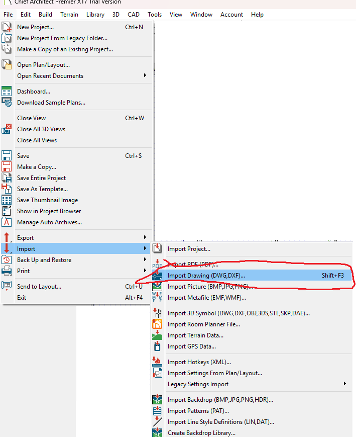
  Open the file menu and select import drawing (DXF)
2. **File ▸ Import ▸ Import Drawing.**
   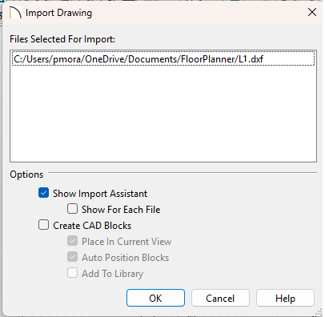
   **Show Import Assistant: ON** · Show For Each File: off ·
   **Create CAD Blocks: OFF** — critical: blocks hide the individual lines
   from CAD to Walls.
3. **Click next**
 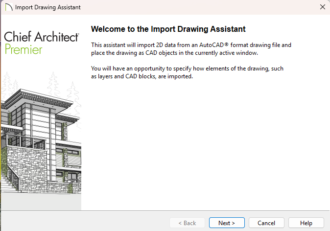
4. **Import Assistant — entity handling.**
   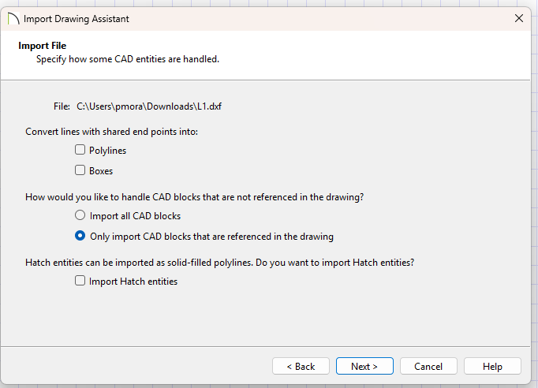
   Convert lines with shared end points into **Polylines: OFF, Boxes:
   OFF** — critical: wall faces share endpoints at every corner by
   construction and must stay discrete LINEs. CAD blocks option is
   irrelevant (the file contains none); Hatch: off. click **Next**
5. **Select Layers.**
   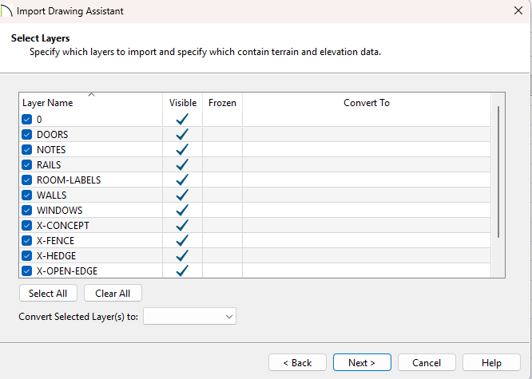
   Leave **all layers checked**; leave the *Convert To* column **empty**
   (it's for terrain elevation data only). click **Next**
6. **Layer Mapping.**
   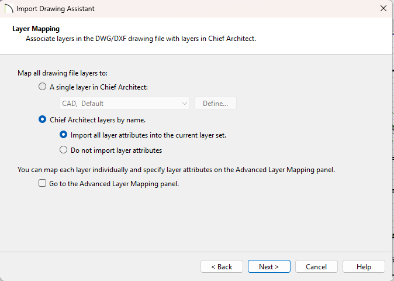
   Select **"Chief Architect layers by name"** with **"Import all layer
   attributes"** — this preserves the FP-* layers, colours and linetypes.
   (The default "single layer" flattens everything: wrong.)
7. **Drawing Unit.**
   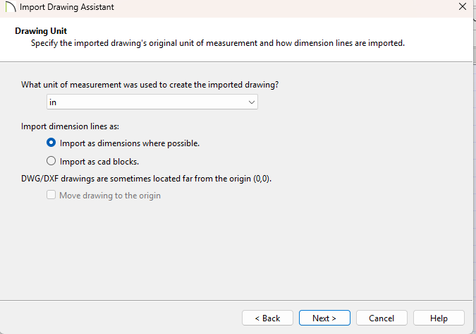
   Unit: **in**, drawing is 1:1. Dimension-line options are moot: the
   plan's drawn dimensions arrive as plain lines and text on
   `FP-DIMENSIONS`, not as DXF dimension entities.

   After Finish, the drawing appears as coloured line work (black walls,
   red doors, blue windows, cyan rails):
   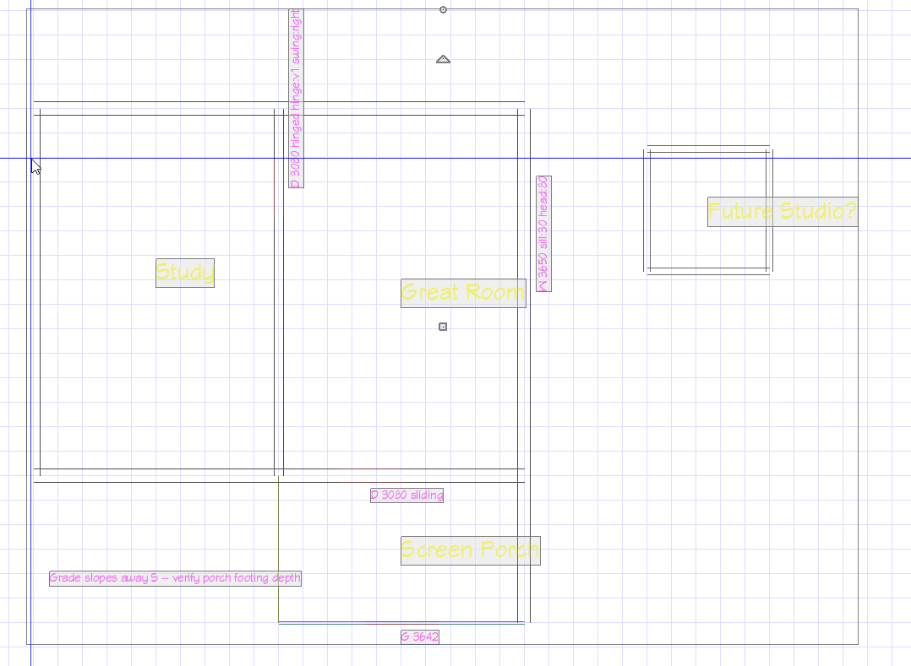
8. **CAD ▸ CAD to Walls… (Ctrl+F3).**
   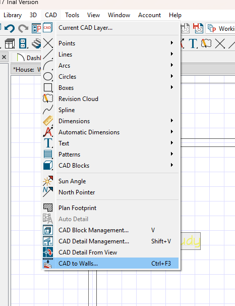
   The layer dropdowns list native and imported layers together — pick the
   **FP-** entries only:
   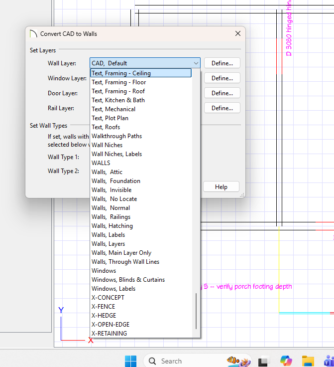

   | Slot | Layer |
   |---|---|
   | Wall Layer | FP-WALLS |
   | Window Layer | FP-WINDOWS |
   | Door Layer | FP-DOORS |
   | Rail Layer | FP-RAILS |

   Set Wall Types: **Wall Type 1 = Siding-6**, **Wall Type 2 =
   Interior-4** (Chief matches a line-pair spacing to a wall type within
   **±1 inch**, so exactness beyond that isn't required — agreement is).
   Never assign any `FP-X-*` layer, nor `FP-DIMENSIONS` /
   `FP-ANNOTATIONS` / `FP-NOTES` — they are drawing, not walls. For the record, the first-session
   dialog below used the merged native `Windows`/`Doors` layers — with the
   FP- prefix this ambiguity no longer exists:
   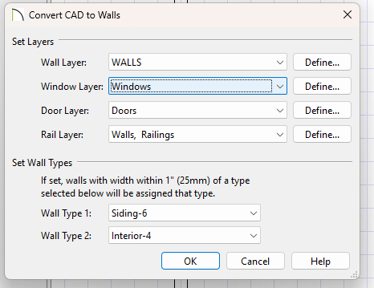
9. **Result.** The first-attempt failure mode that motivated the door
   symbols — both doors arrived as `2640DH` windows (correct width and
   station, wrong class):
   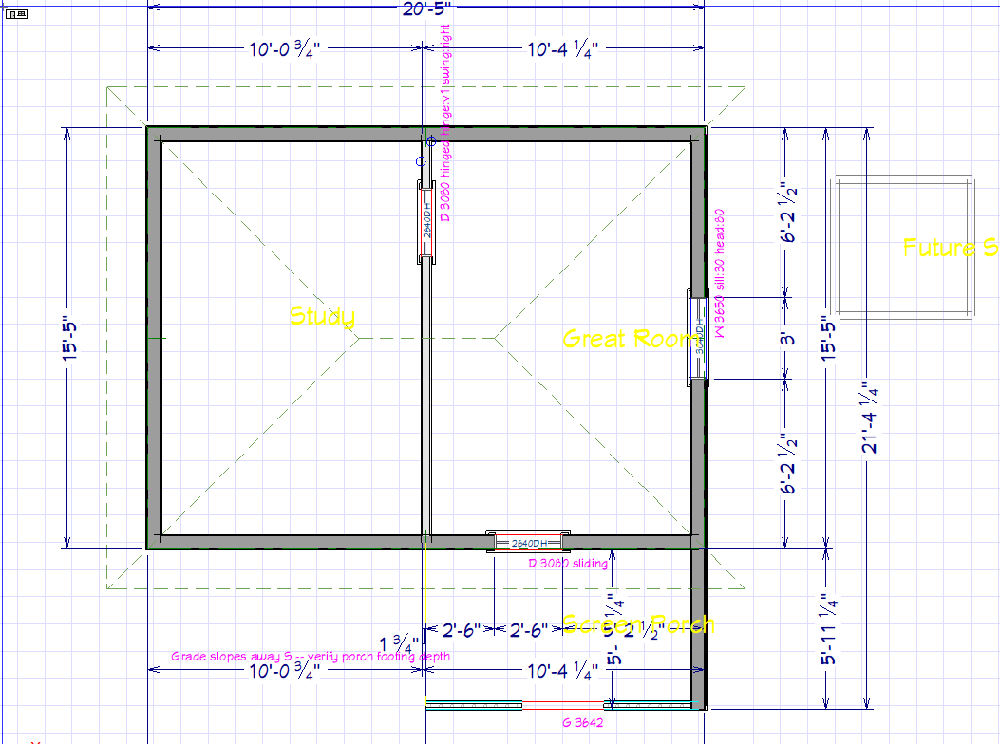

   Converted plan (walls, rooms, auto-dimensions, auto roof) and 3D:
   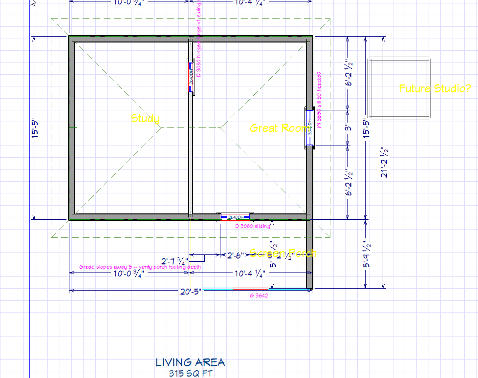
   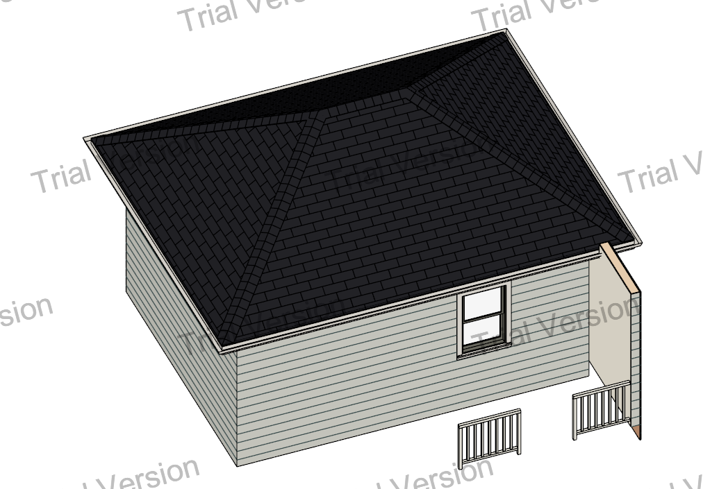

   Chief's auto dimensions measure to its own framing conventions and will
   not literally reproduce sidecar stations; the DXF geometry itself is
   exact. The dashed green perimeter and diagonals are Chief's auto hip
   roof (disable via Auto Rebuild Roofs if unwanted during QC).
10. **Additional floors — importing `L2.dxf` onto a second floor.**

    The export writes **one DXF per FloorPlanner floor** (`L1.dxf`,
    `L2.dxf`, … — named by the level's id), and each one goes onto its
    **own Chief floor**, not onto a Chief *layer*. Chief's layers are
    display layers shared by every floor (the `FP-*` layers from `L1.dxf`
    are the same layers `L2.dxf` will use); which **floor** a drawing lands
    on is decided only by the floor Chief is showing when you import it.

    **a. Know which file is which floor.** In FloorPlanner, the **Floors**
    menu lists every floor with its elevation and height, e.g. *Main Level
    (0" / 108")* and *Upper Level (108" / 96")* in the checked-in sample;
    **Floors ▸ ⟨floor⟩ ▸ Elevation and height…** shows or sets them. A
    floor's id is the file name: the sample's *Main Level* is `L1.dxf`,
    *Upper Level* is `L2.dxf`. A site/lot level has no file (it is
    skipped); a floor whose elevation is below the first is a basement.

    **b. Finish floor 1 first** — steps 1–9 with `L1.dxf`, through CAD to
    Walls. Chief derives a new floor from the one below, so floor 1's
    walls should exist before floor 2 is built.

    **c. Match floor 1's ceiling to FloorPlanner** (optional, for an exact
    stack): FloorPlanner's floor 2 sits at floor 1's elevation + height
    (108" in the sample). In Chief, floor 1's **Finished Ceiling** height
    is the field to set to floor 1's FloorPlanner height (108"); Chief adds
    its own floor platform on top, so its floor 2 rises by that platform
    as well — FloorPlanner has no platform thickness, so a few inches of
    difference in 3D is expected and harmless to the plan.

    **d. Build the second floor.** **Build ▸ Floor ▸ Build New Floor…**
    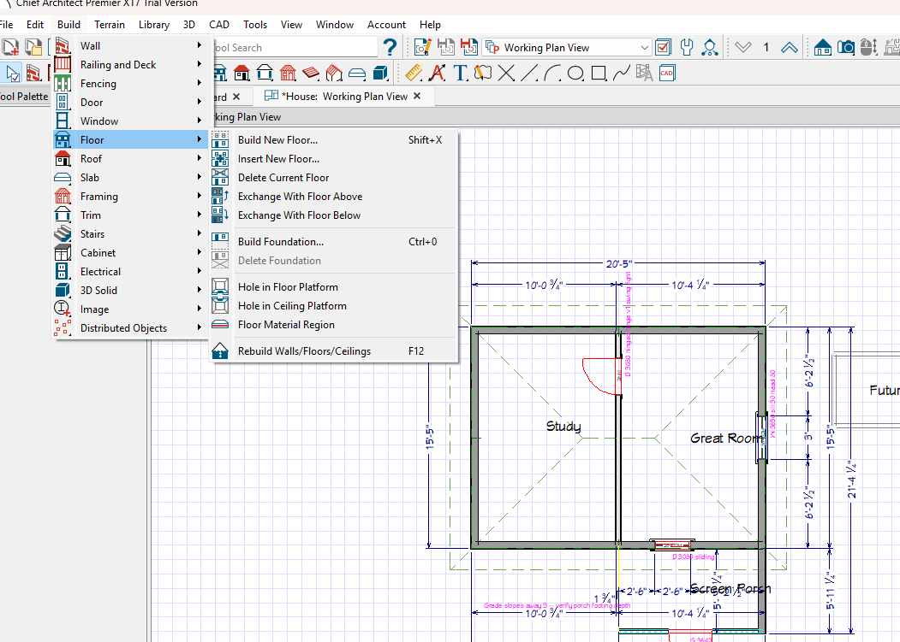
    Choose **"Derive new 2nd floor plan from the 1st floor plan"** and
    accept the floor defaults dialog that follows (*Finished Ceiling* is
    the field to set to floor 2's FloorPlanner height — 96" in the sample
    — if an exact match is wanted):
    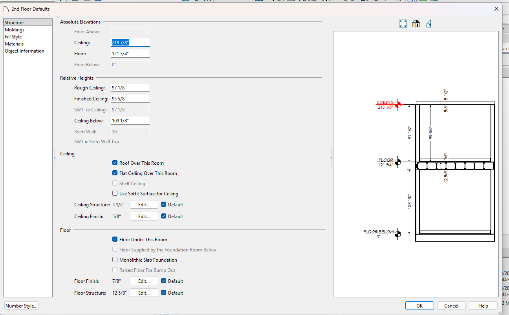
    Chief then **shows floor 2** (the status bar names the current
    floor). If it does not, move up with
    the **Up One Floor** toolbar button before going on: the import in
    step f goes onto **whatever floor is showing**.

    **e. Clear the derived walls.** Deriving copies floor 1's exterior
    walls up as placeholders. On floor 2, **Edit ▸ Delete Objects** with
    the scope on **this floor only** and only **Walls** checked removes
    them (or select and delete them by hand). Don't run it with *All
    Floors* — that would delete floor 1's converted walls too.

    **f. Import `L2.dxf` on floor 2.** With floor 2 showing, repeat
    **steps 1–7 with identical settings**, choosing `L2.dxf`: Create CAD
    Blocks **off**, polylines/boxes **off**, all layers checked, *Chief
    Architect layers by name* with all layer attributes, unit **in**,
    1:1. Chief may say the `FP-*` layers already exist — that is expected
    (they came in with `L1.dxf`); keep the existing ones.
    **Do not move the imported drawing.** Every FloorPlanner floor shares
    one origin, so `L2.dxf` lands exactly over `L1.dxf`'s walls; dragging
    it breaks the stack.

    **g. CAD to Walls on floor 2** — step 8 again, still on floor 2, with
    the same layer slots (`FP-WALLS`, `FP-WINDOWS`, `FP-DOORS`,
    `FP-RAILS`) and the same wall types.

    **h. Check the stack.** Turn on Chief's **Reference Floor** display
    (floor 1 shown greyed under floor 2): the upper walls should sit on
    the lower walls where FloorPlanner has them stacked.
    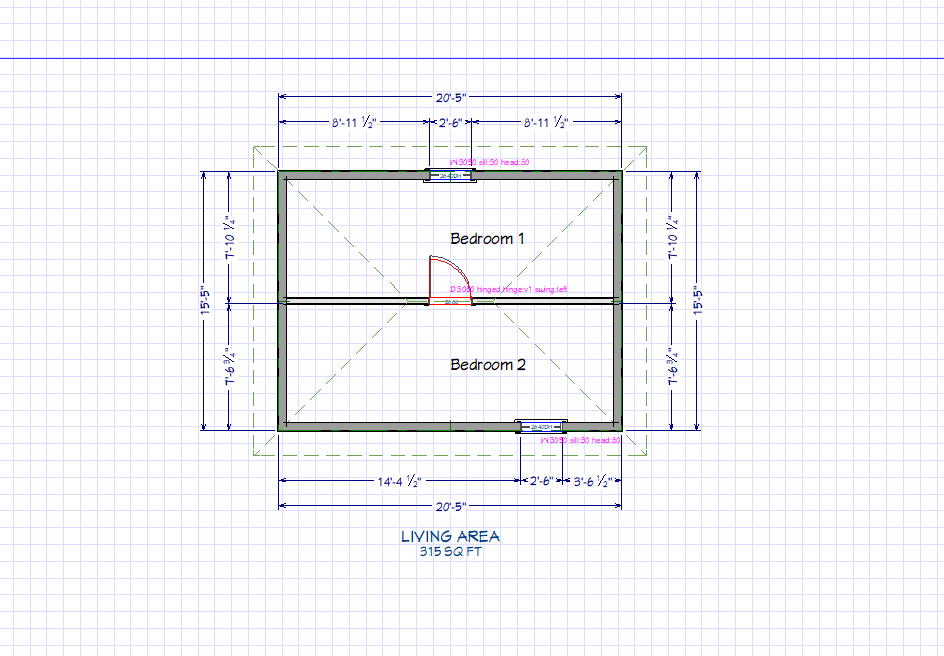

    **A third floor** repeats d–h from floor 2 (*Build New Floor* derives
    floor 3 from floor 2) with `L3.dxf`. **A basement** goes *under* floor
    1 instead — Chief inserts a floor below the first from the same
    **Build ▸ Floor** menu — and takes its own file the same way, imported
    while the basement floor is showing.

    *Verified with screenshots: d's two dialogs and h's result (the
    sample's `L2.dxf`). The rest of a–h, and the third-floor and basement
    notes, follow Chief's standard floor handling and have not been
    re-captured here.*
11. **QC and cleanup.**
   1. Apply what Chief can't take from geometry alone: window sill/head,
      slider door type, verify hinge/swing (the magenta `FP-NOTES` tags
      carry the same data on-plan).
   2. Trace **Invisible walls** over `FP-X-OPEN-EDGE` lines to enclose
      open-edged rooms.
   3. **Edit ▸ Delete Objects** → scope All Floors → check the **CAD**
      group but **uncheck Dimensions, Automatic and Dimensions, Manual**
      (those are live Chief objects, not import residue) → Delete.
      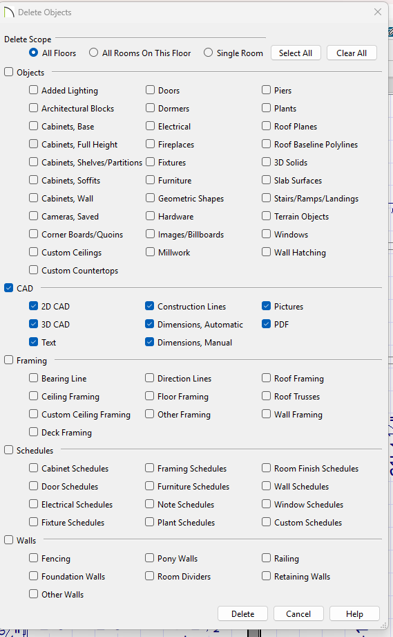

      CAD to Walls *copies* rather than consumes, so this final sweep
      removes the entire imported underlay, leaving a pure native Chief
      model. That includes the plan's exported dimensions and notes
      (`FP-DIMENSIONS`, `FP-ANNOTATIONS`); if you want them in the
      finished model, skip this sweep and turn the other `FP-*` layers'
      display off instead.

### Known limitations

- `cased` / `pass_through` openings ride `FP-DOORS` with a default door
  symbol; convert to Chief's Doorway type during QC (the real kind is in
  the tag/sidecar).
- Wall type carries over only via thickness matching; multi-layer
  assembly definitions are set in Chief per type, once.
- A gate/door with no recorded hinge/swing gets a defaulted handedness
  (`v1`/`left`) purely so it classifies as a door — fix the handedness in
  QC.
- Furnishings, reference images and roofs are not exported (deliberate —
  see above). The plan's dimensions, texts and leaders are, as plain CAD
  lines and text — Chief does not turn them into its own dimension
  objects.
- The reverse direction (a Chief-exported DXF → a FloorPlanner design) is
  not implemented; it needs a real Chief-exported DXF sample to tune the
  wall-pairing pass.

The sample design behind the screenshots above, and the DXF/sidecar pair it
produces, are checked in at [`fixtures/chief-export/`](fixtures/chief-export/)
and pinned by `tests/test_fp2dxf.py` — regenerating them without stating why
is a regression, not routine maintenance.

## Asset pipeline

All SVG artwork (toolbar icons, furnishing symbols, `manifest.json`,
`groups.json`) is generated by `_gen_assets.py` — edit it and re-run to
change or extend the library. Every furnishing SVG uses a viewBox in
inches matching its real footprint, which is what makes true-scale
placement work; see `assets/furnishings/README.md` for how to add your
own symbols. `docs/make_gallery.py` rebuilds the hero screenshot above and
the [feature gallery](docs/gallery/), and `examples/make_examples.py`
regenerates the sample files and previews.

## Development

```bash
pip install -r requirements-dev.txt
pytest              # full headless test suite
pytest --quick      # skip the slower gui tests during feature work
ruff check .        # lint
```

Tests live in `tests/` (see `tests/README.md`); they run headless via Qt's
offscreen platform. Categories are tagged with markers so subsets can be
run or skipped, e.g. `pytest -m "not gui"`.

## Licenses

- Application code: MIT License — free to use, copy, modify, and
  distribute; just keep the credit notice. Created by Patrick Moran with
  Claude (Anthropic). See `LICENSE`.
- Furnishing symbols and toolbar icons: CC0 1.0 (drawn for this project,
  see `assets/furnishings/LICENSE`)
- DejaVu fonts: see `assets/fonts/LICENSE`
- PyQt6 (the GUI toolkit this app depends on): dual-licensed under the
  GPL v3 and a commercial license from Riverbank Computing. See
  [PyQt6 licensing](https://www.riverbankcomputing.com/commercial/license-faq)
  and the [GPL v3 text](https://www.gnu.org/licenses/gpl-3.0.html).
