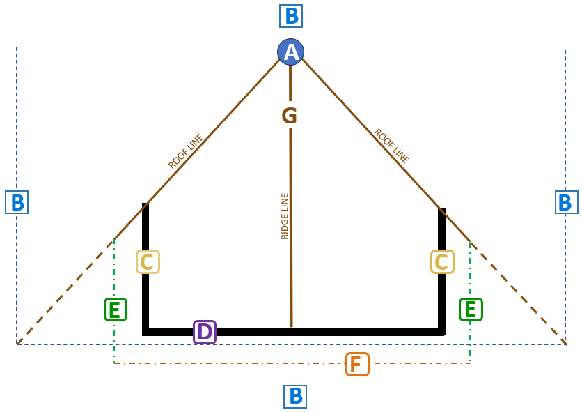

**Instructions for the Dormer Control Knobs Functions for the Floorplanner**

This is the instruction set for Claude to build the required python control functions in the Floorplanner application. 

Refer to this figure for the letters description below.

Scan the image and pick out the letters A, B, C, D, E, F, and G, and their colors which are key for the instructions below. In addition, notice that there are 2 diagonal brown lines, that are defined here as the "roofline" which represents where the dormer roof and the roof it sits one, intersect. There is also a brown line, labeled the "roof-ridge" which represents the top of the dormer. This ridge line will always be level and extend out from the apex to the gable end of the dormer. 
This is a plan view of the dormer control knobs functions for the Floorplanner. References to up, down, left, right, vertical, and horizonal refer to the image (plan) view. When the actual dormer is built, the control knobs are used to adjust the dormer's dimensions and position. The dormer roof, walls, and eaves that are part of the 3D view are calculated from the controls given in these instructions and captured in the schema of the Floorplanner tool. 

***Adding a dormer to the floorplan***

When the user holds the shift key down while the H command (dormer tool) is active and the user clicks on a roof, the dormer structure is built based on a roof that is under the mouse click. The pitch of the dormer is the same as the pitch of the roof under it. There is a dormer dialog box that minics these controls where the user can enter real values after the dormer has been added.  This description doesn't define how that dialog box is formatted except that there must be at least one entry that allows the user to change the pitch of the dormer roof.

***Controls for the dormer once it is added to the plan view.***

  Control A. In white, the circular apex control point allows the user to move it either the left or the right to adjust the ridgeline left or right within the blue frame defined by the blue dashed line.

  Control B. These controls are shown on the left, right, top, and bottom of the gable end dormer.  When the user clicks and drags on the right B control, in blue, the right edge of the dormer box stretches left and right. When the user clicks on the left blue control, B, the user can stretch the left side of the dormer box left and right. When the user clicks on the top control B, in blue. The box grows in the vertical direction by the drag amount. IMPORTANT: In this case the entire structure of the dormer roof, shown in brown, grows vertically. The dormer roof-ridge grows up and down, as do the roof-lines which are the slanted brown lines on the left and right. They always maintain their angle with respect to the roof-ridge, G. This moves the apex up and down on the roof that it sits on. If the dormer box grows too tall, the diagonal lines, in brown, may no longer touch the corners on the lower right and lower left of the dormer outline box in dashed blue. The brown lines always maintain their angle as the blue control knobs are moved. This angle is set by the pitch of the roof that it sits on (or through a dialog box entry).  The visual indication is that the angle with respect to the ridge line, G, will be determined by the pitch of the dormer roof and the roof the dormer sits on.  (The dialog box is the only way the dormer pitch may be changed. Hence, there is no way to change the symmetric angle of the brown roofline angles in this plan view.) Moving the left and right controls, B will only serve to clip the end of the diagonal rooflines lines.  The only way to change the pitch is to open the dormer editor control dialog and set the pitch there. The left and right control knobs, B, will be limited on the outside left and right by the roofs lower edge that it sits on. 

  Control C.  When the user clicks and drags on the yellow control boxes, C, the black vertical bars, which represent outside vertical wall under the dormer roof, move left or right. The left and right drag limits are set by the roof-ridge, G, and the ends of the diagonal brown roof-lines. The left control, C, is limited to the left side of the dormer defined by the roof-line. Vice versa for the right outside vertical walls. 

  Control D. When the user drags on the control knob D, in purple, the horizontal outside wall, in black, moves up and down. The limit of the vertical drag is the minimum vertical junction of the vertical walls (defined by C) vertically. The horizontal limit is set by the edge of the roof that wall sits on.  

  Control E. Controls E define the left and right eaves for the dormer. The left is a horizontal drag control that lets the user extend the eaves outside the edge of the left outside vertical wall. The limits on the eaves is from the outside left wall, C, to the left diagonal roof-line joint, in brown. The right side has the same limits but on the right side. When the user drags the left or right eaves, the horizontal eave (described next), shown in the orange dashed line, connects to that vertical these green dashed vertical eaves line by projecting the orange line, left or right, to the intersection of green eaves lines. Additionally, the left and right roof eaves will determine the extent to which the left and right roof-lines contact the underlying roof. This is shown as the dashed brown line in the figure. The dashed lines are where the roof-line would be if the ridge eaves and or the walls, C are changed. 

  Control F. The control F, in orange, is the roofline overhang on the gable end roof. F may be dragged vertically from the limit of the gable end, D, down beyond the blue box defined by the horizontal blue dashed line below it. When the F is dragged, the vertical eaves are projected up/down to intersect the orange gable eave.

  Control G. G is the ridge-line control, in brown, and may be dragged from the left wall to the right wall (either the left C or the right C). A, in white we’ll track the ridgeline. Remember that when the user drags the ridge-line, the gable end eaves are projected up/down to intersect the orange gable end eave, and the roof-lines keep their angle and the vertical walls, (controlled by C), will grow or shrink vertically to intersect the new roof-line intersections. 

  When the user double-clicks on A, in white, the dormer dialog box is opened where the user may define any of the dimensions shown in the figure. In particular, the pitch of the dormer roof is available in the dialog box.

  We will add a switch in the dialog box set the dormer to symmetrical control so that the left and right eaves are the same. 
