# Feature gallery

Each image highlights one feature.  All are regenerated from a single demo
plan by `python docs/make_gallery.py` — don't hand-edit the PNGs.

### Overview
The whole plan at a glance — walls, rooms, furnishings and the toolbar
**Totals** (cost / sq ft).

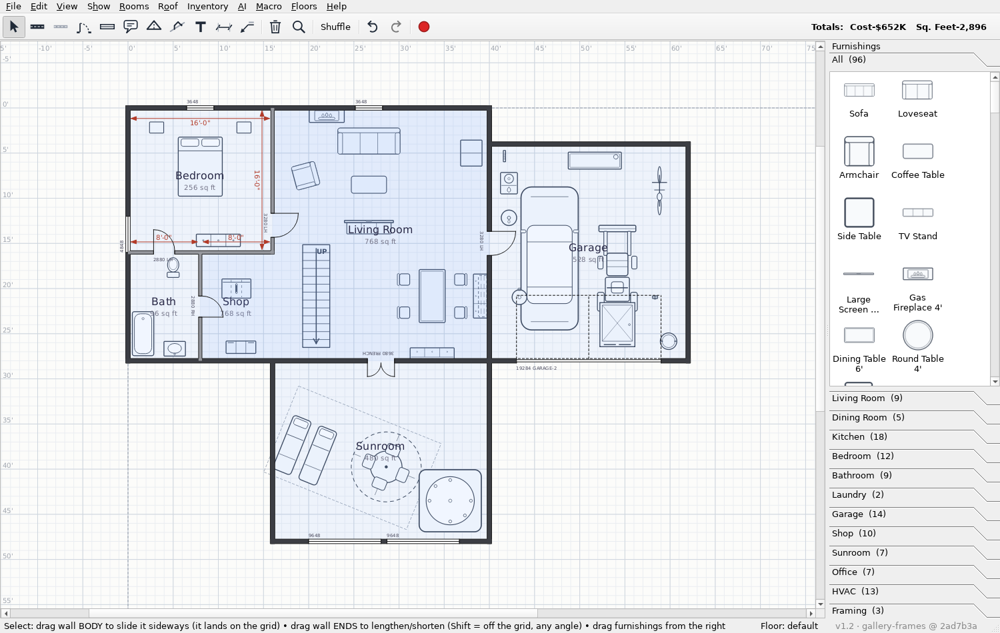

### Furnishings at true scale
A bundled CC0 library of 96 top-view symbols; drag from the right-hand
palette and each lands at its real footprint.

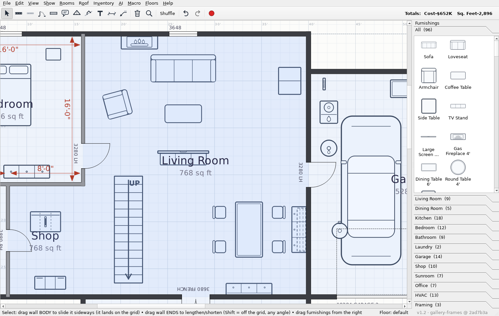

### Doors & windows
WWHH-sized openings that cut the wall and ride it when dragged, including
single/double garage doors with a dashed overhead outline.

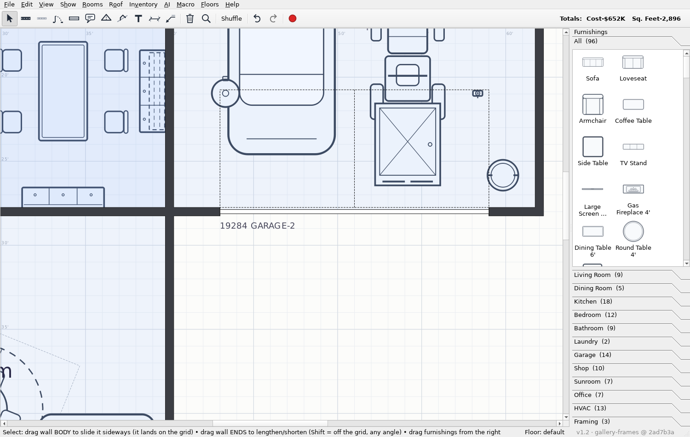

### Rooms
Click an enclosed area to name it; the room computes its true area and can
draw dimension arrows on every wall.

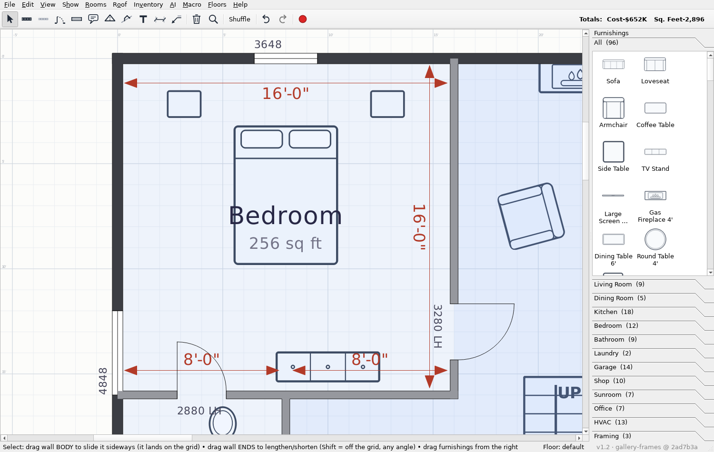

### Stairs (Framing)
A dynamic stair whose step count comes from the room's ceiling height, with
an UP / DN travel arrow; full or half flights.

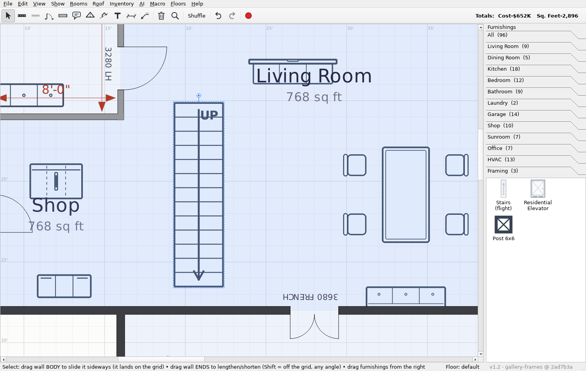

### Groups & rotation
Group items and move/rotate them as one — the selection box and rotation
handle orient with the group.

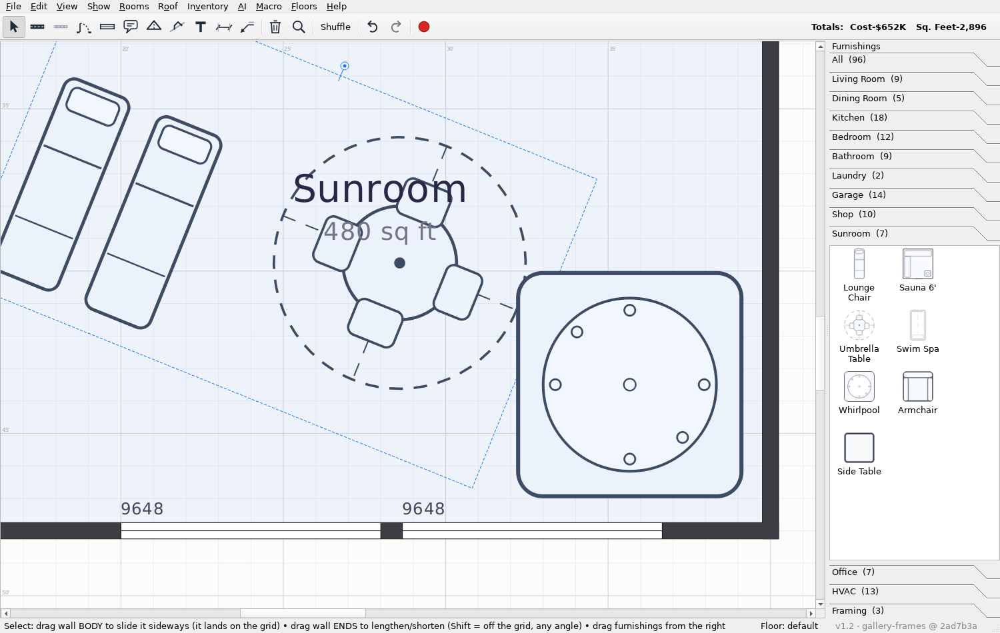

### HVAC equipment
Furnaces, water heaters, panels, well pump, car charger and more.

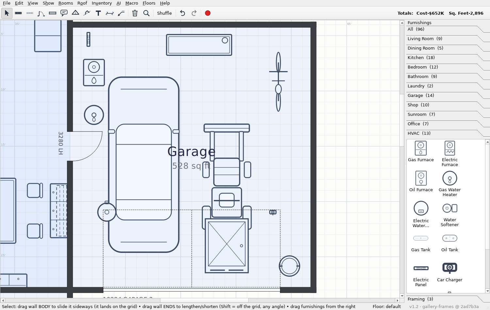

### Rooms own their walls — and can be left partly open
Detach a wall to unlock its corners; pull a corner away and that side
**opens** (dashed), so a room needn't be walled on every side.

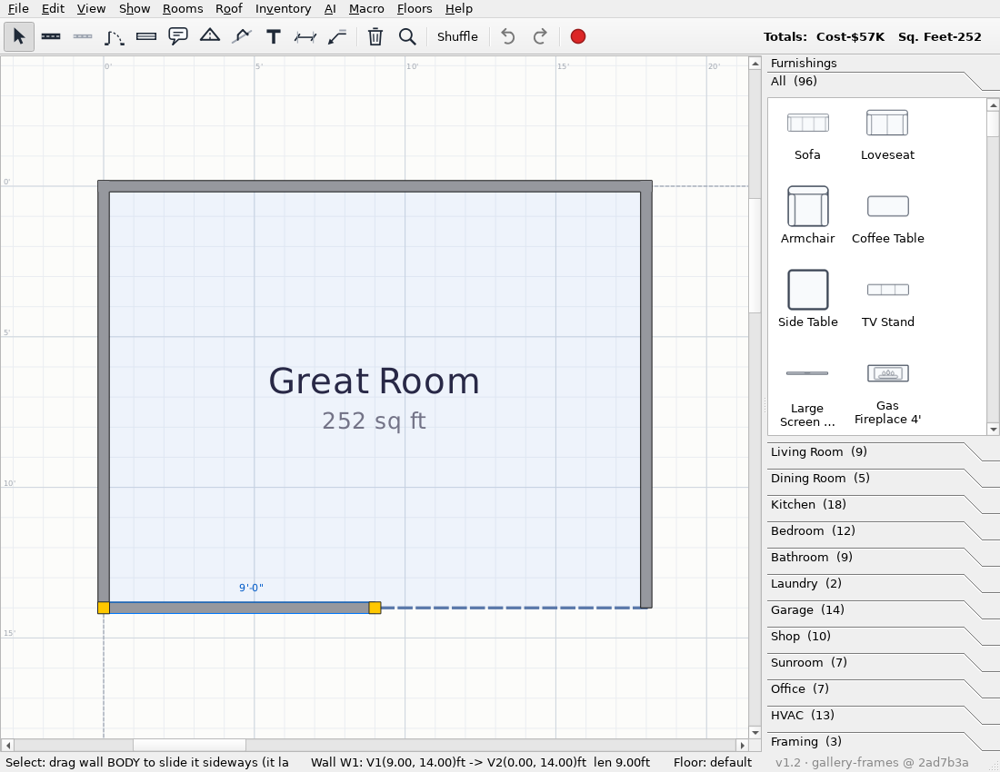

### A clean door between rooms
Adjacent rooms each own their own wall on the shared boundary; a door
belongs to one of them and the coincident wall **opens** for it — a single
door, never two stacked on top of each other.

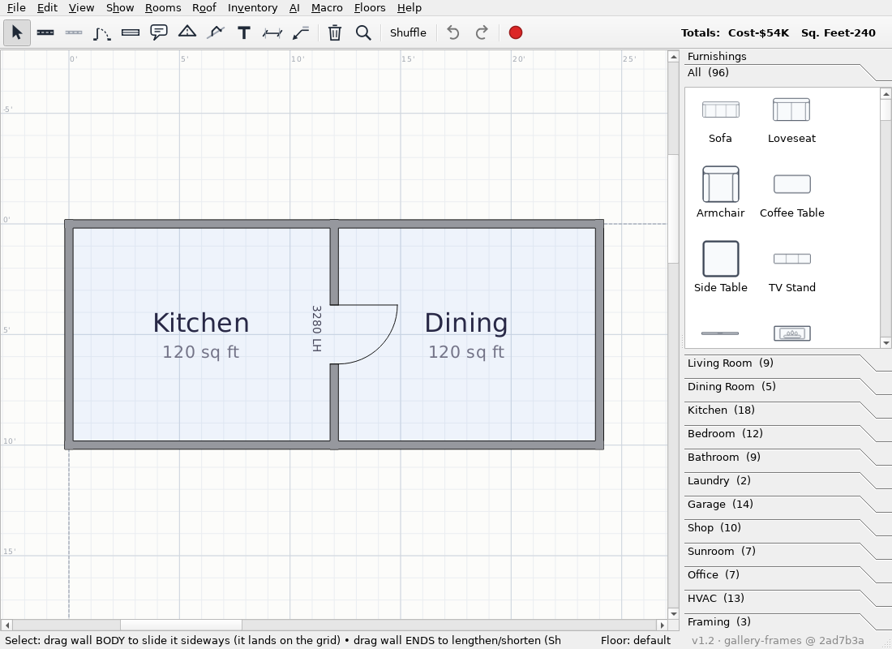

### Bathroom fixtures
A master bath with both luxury walk-in showers — a floor-to-ceiling **glass
walk-in shower** (5' × 4') and a tiled walk-in shower with a bench — plus a
toilet and a **double-vanity base**, all at true scale. Standard kitchen and
bath **base cabinets** (door bases, drawer base, sink base, corner
lazy-susan, vanity bases) are in the Kitchen and Bathroom palette sections.

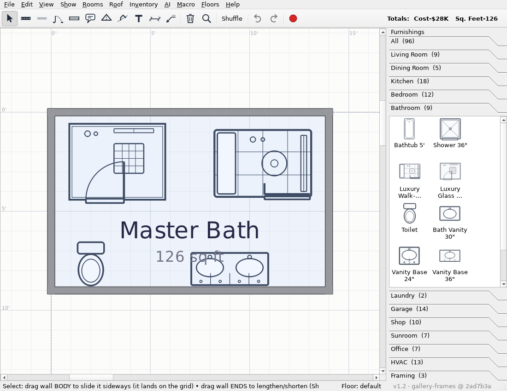

### Kitchen cabinets
A run of standard **base cabinets** along the back wall — corner lazy-susan,
door bases, a sink base and a drawer base — with **wall cabinets** drawn
dashed (overhead) above them, a centre **island** with cabinets and a
seating overhang, plus a row of tall **pantry cabinets**, all at true scale.

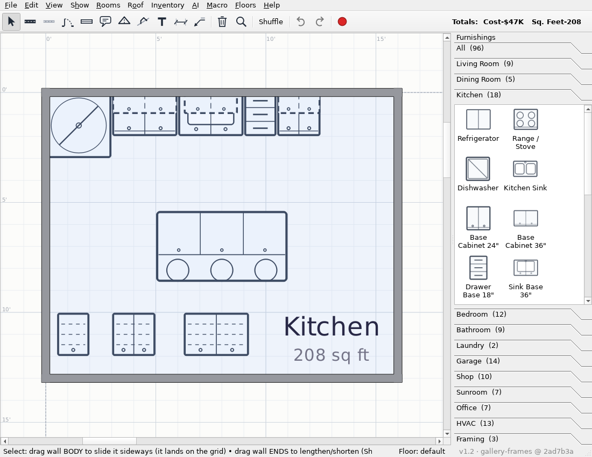

### Inventories (Excel-ready)
House / Interior / Yard / Total tables; **Copy to clipboard (TSV)** pastes
straight into a spreadsheet.

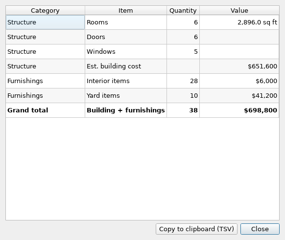

### AI furnishing pricing
The **AI** menu fetches current purchase prices for the whole catalog from a
chosen AI system via an editable prompt.

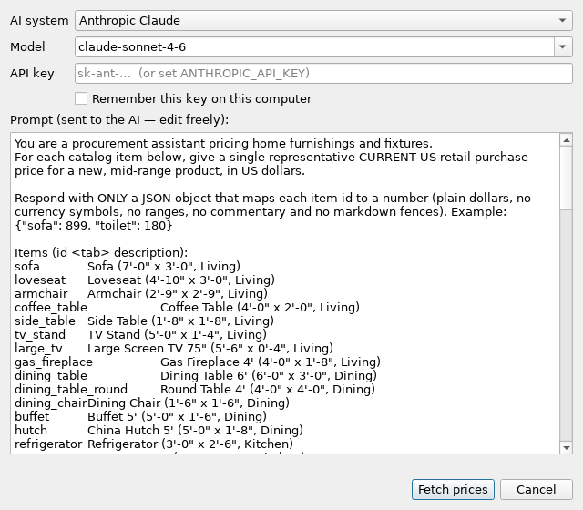

### Help ▸ About
Where the app keeps your designs and settings, using OS-standard locations.

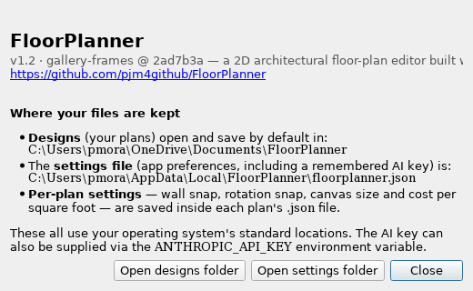

### Headless macro driver
`fp_macro.py` drives the app with no GUI: a line of macro tokens goes in
(menu/shortcut chords, mouse/arrow keys, and high-level `PLACE`/`WALL`/`ROOM`
commands), and a rendered SVG/PNG snapshot plus a JSON summary of the layout
come out — so a script or an AI can edit a plan and **see** the result. See
[`docs/macro_language.md`](../macro_language.md).

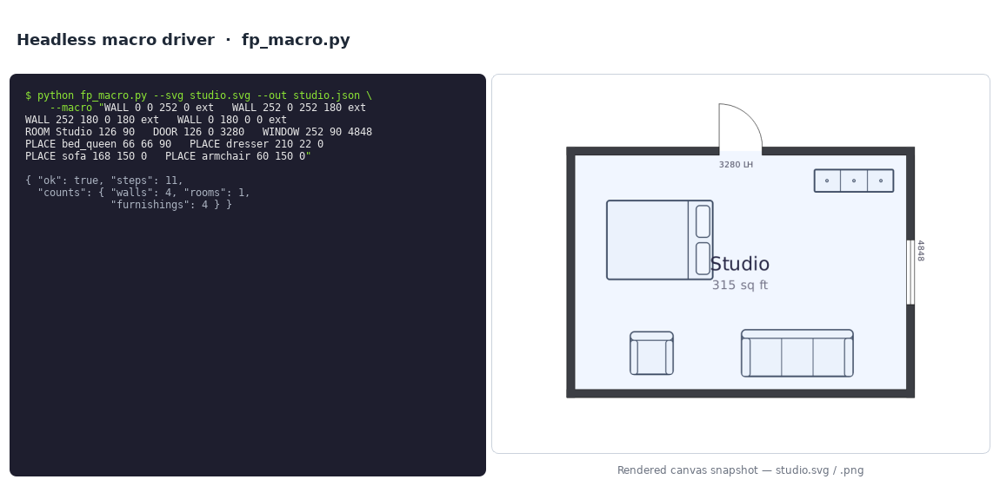

### Macro recorder / debugger
The **Macro ▸ Record / Debug…** window records your clicks, keys, tool
changes, context-menu choices and dialog text as editable macro tokens;
select any portion and **Replay** it, or **Save As** a `.fpm` file to run
later with `fp_macro.py`.

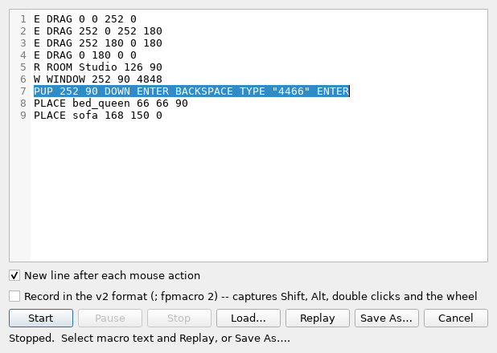

### Roofs
Three roof forms on one house: a **gable** over the main block with a
**dormer** on its south slope (sketched the way the Dormer tool does it —
its sides and face projected up from the host roof), a **hip** over the
garage with a settable run per end, and a **shed** over the sunroom. Roofs
clip each other along their valleys; the grips (*Roof ▸ Edit roof*) move a
ridge, an end or the eaves.

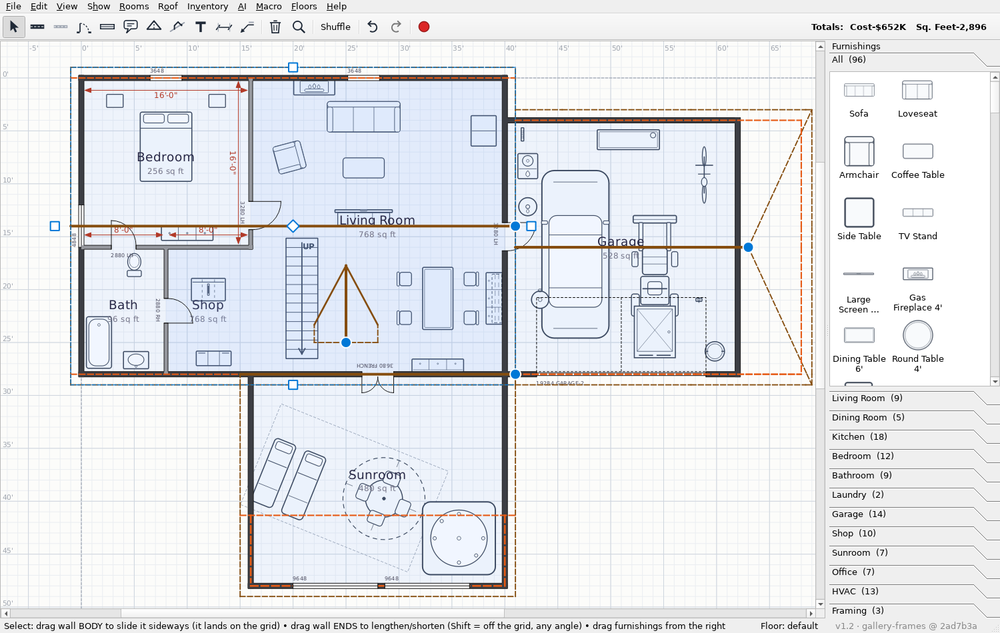

### The End-On dialog
The section a roof's parameters edit, drawn as it is edited: ridge and eaves
heights, the pitch, the form, the eaves span and overhang per side, each end
gable or hip with its run.

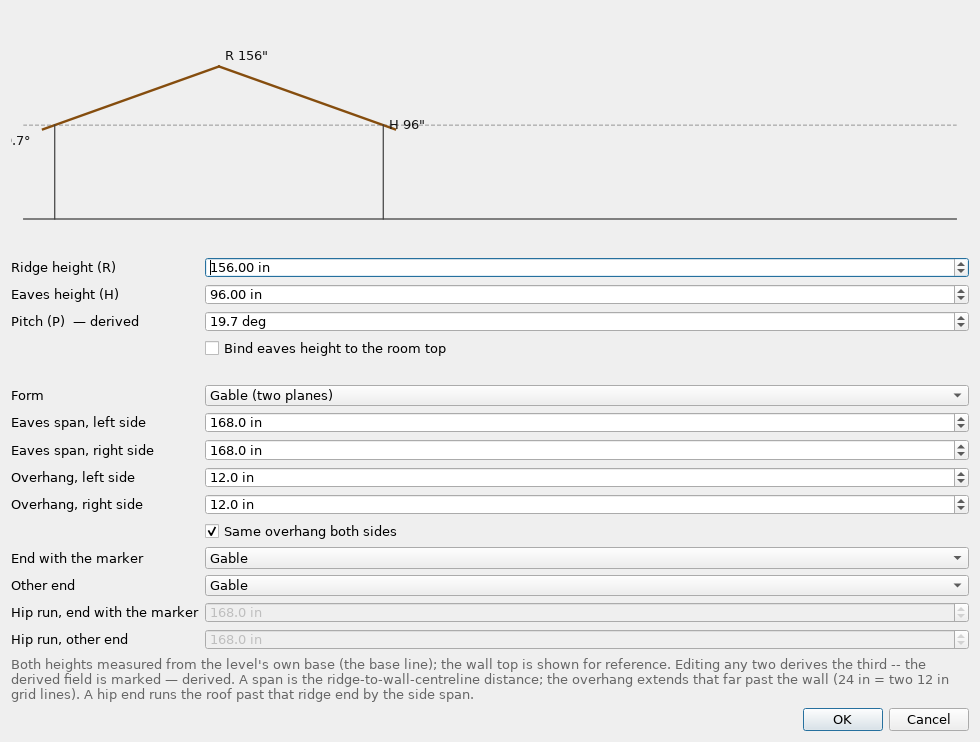

### Annotations, measurements, leaders and item callouts
A **text** (the T tool), two **measures** (the L tool: each end snapped to a
corner, one thin line with a slash at each callout point, the length in
feet-and-inches; the selected one shows its four small black knobs), a
**leader** (the N tool: an arrow at the point, the text on a short
shoulder), the level's **datum**, and the **item callouts** — every item's
session label (`W7`, `V12`, `O3`, `R2`, `F4`) in one small font and one
colour, the labels the Malformed-design report speaks in. The **Show** menu
switches each layer on its own.

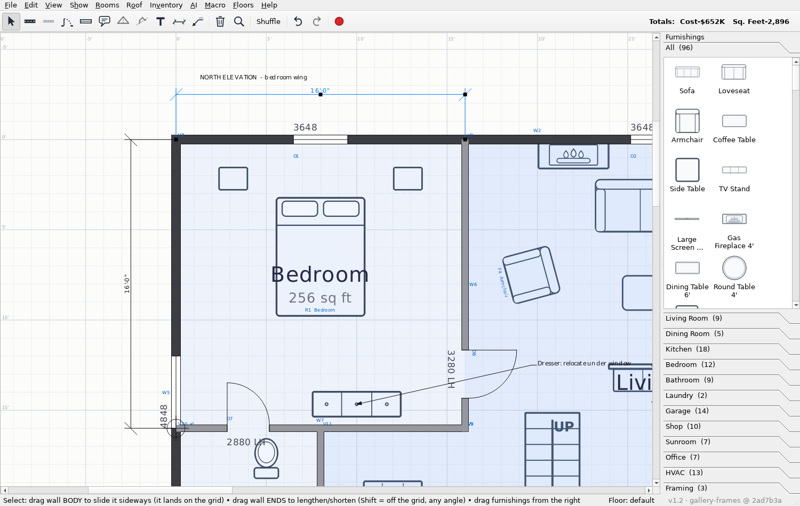

### 3D view
The same plan rendered by the Qt Quick 3D viewer (**View ▸ 3D view**, or
`python -m floorplanner.viewer.fp3dq plan.json --shot out.png` from the
command line): walls cut by their openings, floors, the three roofs and
the dormer, furnishings as blocks.

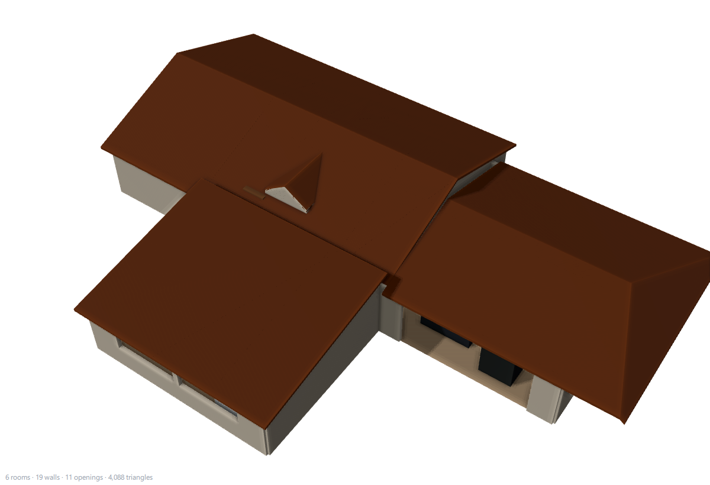
